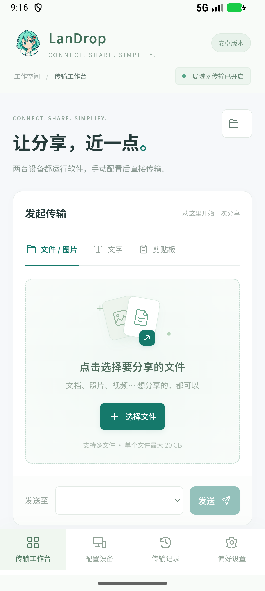
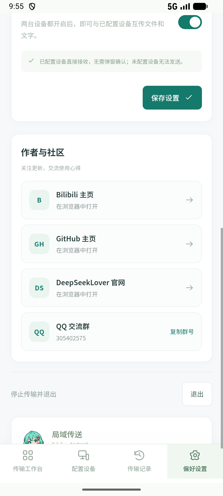

# LanDrop Android · 局域传送

<p align="center"></p>

**在同一局域网内，直接在安卓手机与电脑、两台安卓手机之间分享文件和文字。**

沿用 [PCdeliver 桌面版](https://github.com/Hjnandlizhiyan/PCdeliver) 的薄荷绿界面与少女形象，支持简体中文 / English，无需登录或云端中转。

[简体中文](#使用方法) · [English](#english) · [下载 APK](https://github.com/Hjnandlizhiyan/LanDrop-Android/releases/latest)

## 下载与安装

当前版本：**0.1.2** · Android **8.0+** · 包名 `com.deepseeklover.landrop`。

- [下载签名 APK](https://github.com/Hjnandlizhiyan/LanDrop-Android/releases/download/v0.1.2/LanDrop-Android-0.1.2.apk)
- [SHA-256 校验文件](https://github.com/Hjnandlizhiyan/LanDrop-Android/releases/download/v0.1.2/SHA256-0.1.2.txt)
- [Windows 电脑版](https://github.com/Hjnandlizhiyan/PCdeliver/releases/latest)

发布包使用作者提供的正式签名。后续相同包名、相同签名的更新可覆盖安装，并保留配置和记录。

**如果之前安装的是 debug 测试包，正式包因签名不同不能直接覆盖。** 请先在旧版中把重要接收文件另存到普通文件夹，记录设备配置，然后卸载测试包并安装正式包。默认应用目录中的文件会随卸载删除。

## 使用方法

1. 两台设备都安装并打开 LanDrop，连接同一 Wi-Fi 或局域网。
2. 手机首次运行时，允许所需的本地网络 / 附近设备访问；通知可显示后台接收状态。
3. 打开“配置设备”，查看自己的连接地址。**双方互相添加对方的 `IPv4:45878`**，例如 `192.168.1.20:45878`。
4. 回到工作台，选择在线设备，选择文件或输入文字后发送。已配置设备直接接收，无需逐次确认。
5. 在“传输记录”查看接收内容。文件可打开、分享、另存；文字可查看和复制。

手机之间同样需要互相添加地址，传输不需要电脑中转。在其他应用中使用系统分享菜单，也可以把文件或文字发送给 LanDrop。

网络改变导致 IP 变化时，需要更新地址。访客 Wi-Fi、路由器设备隔离、VPN 或电脑防火墙可能阻止连接；请使用当前局域网地址，`127.0.0.1` 仅用于本机调试。

## 功能

- 安卓 ↔ Windows、安卓 ↔ 安卓，双向传输文件和文字，兼容桌面版 `landrop-v1` 协议。
- 多文件选择、系统分享、剪贴板复制和粘贴。
- 流式文件传输、进度、速度、取消、SHA-256 完整性校验；同名文件自动编号。
- 工作台、设备、传输记录和偏好设置，手机底部导航与平板布局。
- 简体中文 / English 即时切换并保存；设备配置和历史保存在本机。
- 系统文件夹授权，可选择接收位置；接收成功提示、后台传输通知与退出按钮。
- 偏好设置中的 Bilibili、GitHub、DeepSeekLover 官网和 QQ 交流群入口。

单个文件协议上限为 **20 GB**；这不是已经完成 20 GB 实机验证的承诺。文件夹请先压缩。暂不支持自动发现、断点续传、文件夹直接发送或端到端加密；请在可信局域网中使用。

## 接收位置与后台运行

建议在“偏好设置 → 选择文件夹”授权普通目录，例如 `Download/LanDrop`。系统不允许直接授权 Download 根目录时，先建立子文件夹。

默认接收位置为应用的外部文件目录 `Android/data/com.deepseeklover.landrop/files/Download/LanDrop`，**卸载应用会删除这个默认目录**。删除或清空传输记录不会删除已完成的接收文件。

返回手机主屏后可由前台服务继续接收，通知或设置页可停止传输。系统强制停止、断网或厂商省电策略仍可能中断接收；软件不会开机自启。

## 界面预览

<p></p>

## 更新记录

- **0.1.2**：偏好设置新增作者主页、官网和 QQ 群复制入口，支持中英文。
- **0.1.1**：修复设备选择框随状态刷新闪烁，保留当前选择；设备离线时恢复提示。
- **0.1.0**：安卓初版，支持文件与文字互传、系统分享、接收目录、历史和后台接收。

## 构建

用 Android Studio 打开项目，安装 Android SDK **37**，使用项目的 Gradle Wrapper 和 **JDK 25**。界面资源已随源码提供，构建不需要重新生成它们。

```powershell
.\gradlew.bat assembleDebug lintDebug
```

调试 APK 输出到 `app/build/outputs/apk/debug/app-debug.apk`。正式发布请通过 Android Studio 的 **Generate Signed App Bundle or APK** 使用自己的签名；私钥和签名密码不在仓库中。自行签名的 APK 无法覆盖作者签名的发布包。

## 项目结构与验证

- `app/src/main/java/com/deepseeklover/landrop/`：局域网协议、前台服务、系统分享、目录授权与受限 WebView 桥接。
- `app/src/main/assets/`：界面、图像、中英文翻译和手机布局。
- `verification/`：协议互通与模拟器验证脚本，见 [验证说明](verification/README.md)。
- `docs/`：界面预览与验证结果。

已验证协议核心与真实桌面服务的文件/文字互通，以及调试 APK 在模拟器中的系统选择器、目录授权、后台接收、中英文布局、作者入口和选择框稳定性。本次正式 APK 的签名、版本和内置界面资源已校验；未把这些结果表述为各品牌真机或大文件长时间传输验证。

## 作者与交流

[Bilibili](https://space.bilibili.com/521952225) · [GitHub](https://github.com/Hjnandlizhiyan) · [DeepSeekLover 官网](https://www.deepseeklover.com)

QQ 交流群：**305402575**。问题反馈可使用本仓库 Issues；请说明设备型号、系统版本和连接方式，分享日志前移除个人文件名与地址。

## English

LanDrop Android shares files and text directly between Android phones and Windows computers on the same local network. It uses the `landrop-v1` protocol of [PCdeliver](https://github.com/Hjnandlizhiyan/PCdeliver), with Chinese/English UI, a mint-green design, and local storage.

### Download and connect

Download the signed **0.1.2 APK** from [Releases](https://github.com/Hjnandlizhiyan/LanDrop-Android/releases/latest). Android **8.0 or newer** is required.

1. Open LanDrop on both devices and connect them to the same LAN.
2. Grant the requested local network permission. Notifications show background receiving.
3. In **Devices**, add each other's LAN IPv4 address and port, such as `192.168.1.20:45878`. Configure both sides.
4. Choose the online recipient and send files or text. Use **History** to open, share, save, or copy received content.

Phones can transfer directly to each other without a computer. Devices must be added manually; update their addresses when their IP changes.

### Updates, storage, and limits

Future releases using the same signing certificate can update in place. **A release APK cannot replace an earlier debug build with a different signature.** Save important received files outside the app directory and note your device settings before uninstalling a debug build. Uninstalling deletes the default app receive folder.

Choose a regular receive folder in Preferences. Transfers can continue through a foreground service, but force-stop, network loss, and device power management can interrupt them.

The protocol supports files up to 20 GB, but full-size real-device transfers have not been validated. No automatic discovery, resumable transfers, direct folder transfers, or end-to-end encryption is provided. Use a trusted LAN.

### Development

Open the project in Android Studio with SDK 37 and JDK 25, then run `./gradlew assembleDebug lintDebug`. Bundled UI assets are ready to build. Signing keys are not included. See [verification/README.md](verification/README.md) for optional protocol and emulator checks.

Creator links: [Bilibili](https://space.bilibili.com/521952225), [GitHub](https://github.com/Hjnandlizhiyan), [DeepSeekLover](https://www.deepseeklover.com). QQ community: **305402575**.
